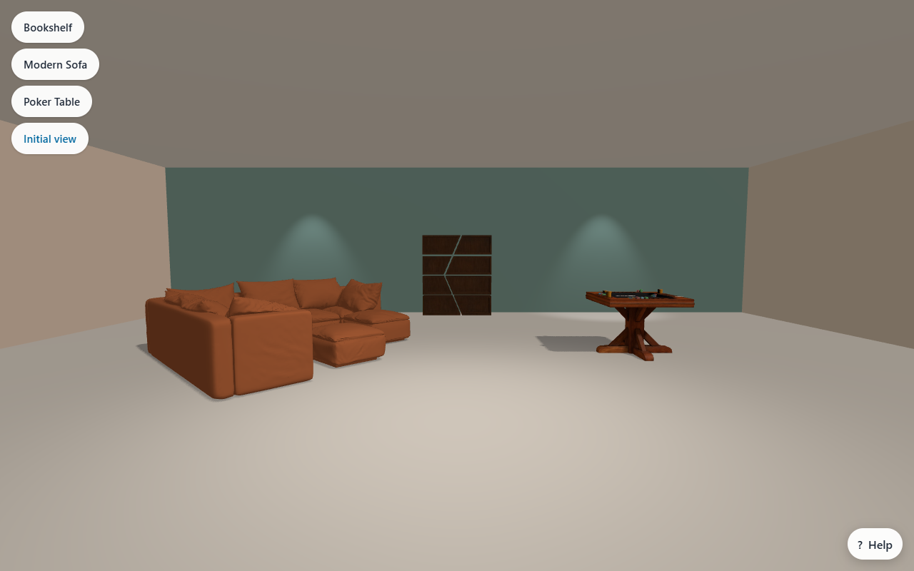
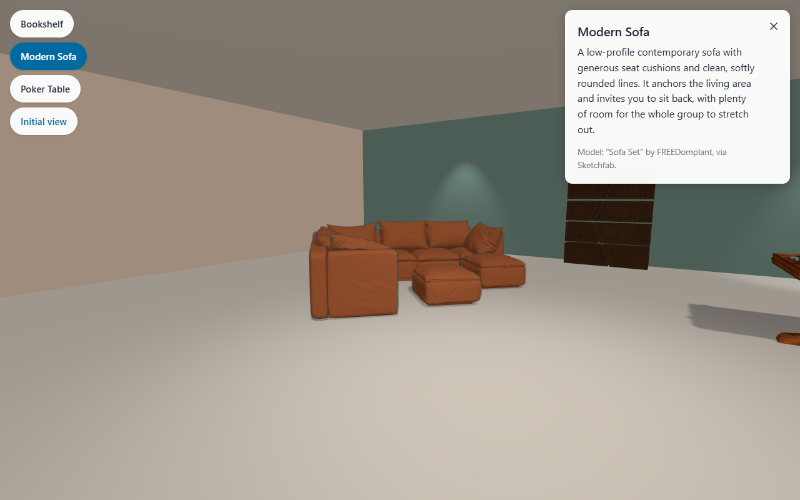

# 3D Room Tour & Descriptions

An interactive 3D living room that runs entirely in the browser. Walk around by clicking the floor, click or tap any piece of furniture to zoom in on it and read about it, and use the keyboard-friendly furniture list if you prefer not to use a pointer.

[](https://angular.dev/)
[](https://threejs.org/)
[](https://www.typescriptlang.org/)
[](https://vitest.dev/)
[](LICENSE)
[](https://room-tour-and-descriptions.vercel.app/)

**[Open the live demo](https://room-tour-and-descriptions.vercel.app/)**


|                                             Desktop                                              |                                        Mobile                                        |
| :----------------------------------------------------------------------------------------------: | :----------------------------------------------------------------------------------: |
|                             |                    |
|  |  |

## Table of contents

- [Features](#features)
- [Controls](#controls)
- [Tech stack](#tech-stack)
- [Getting started](#getting-started)
- [Scripts](#scripts)
- [Architecture](#architecture)
- [Technical decisions](#technical-decisions)
- [Performance](#performance)
- [3D model credits and licenses](#3d-model-credits-and-licenses)
- [Contributing](#contributing)
- [License](#license)
- [Author](#author)

## Features

- **Walk the room**: click or tap the floor and the camera glides there, limited to the room bounds.
- **Inspect furniture**: click or tap a piece and the camera moves close to it, the piece gets an outline and a description panel opens. Hovering shows which pieces are clickable.
- **Orbit, pan and zoom** with mouse, touch (one-finger rotate, two-finger pan and pinch) or the arrow keys.
- **Accessible alternative**: a list of the furniture (plus an _Initial view_ button) works with the keyboard and screen readers; the description panel is announced as a dialog and closes with `Esc`.
- **Responsive**: the initial framing adapts to portrait screens so all three pieces stay visible on a phone.
- **Realistic lighting**: soft shadows, matte walls and tuned material for the sofa.
- **Loading and error states**: a progress screen while models download, and clear messages (with a retry button) if WebGL is unavailable, the context is lost or a model fails to load.
- **Light assets**: the three models were reduced from about 51 MB to about 2.4 MB (see [Performance](#performance)).

## Controls

| Input                                       | Action                     |
| ------------------------------------------- | -------------------------- |
| Left mouse drag / one finger                | Look around                |
| Right mouse drag / two fingers / arrow keys | Slide sideways             |
| Wheel / pinch                               | Zoom                       |
| Click or tap the floor                      | Walk to that point         |
| Click or tap a piece of furniture           | Zoom in and read about it  |
| `Esc`                                       | Close the details panel    |
| `Home`                                      | Return to the initial view |

The **? Help** button in the corner reopens these instructions at any time.

## Tech stack

| Area            | Technology                                                                          |
| --------------- | ----------------------------------------------------------------------------------- |
| Framework       | Angular 21 (standalone components, signals, zoneless change detection)              |
| 3D              | Three.js 0.187 (`three/addons` for `GLTFLoader`, `OrbitControls`, `MeshoptDecoder`) |
| Language        | TypeScript 5.9 (strict)                                                             |
| Styling         | SCSS with CSS custom properties; no UI component library                            |
| Unit tests      | Vitest 4 with jsdom, through the Angular `@angular/build:unit-test` builder         |
| Lint and format | ESLint 9 (flat config, `angular-eslint`, `typescript-eslint`), Prettier             |
| Git hooks       | Husky + lint-staged                                                                 |
| CI              | GitHub Actions (lint, build, test on Node 22)                                       |
| Hosting         | Vercel (deploys on every push)                                                      |

## Getting started

Requirements: Node.js 22 or newer and npm.

```bash
git clone https://github.com/frxncismor/room-tour-and-descriptions.git
cd room-tour-and-descriptions
npm ci
npm start
```

Open <http://localhost:4200>. The viewer needs a browser with WebGL enabled.

## Scripts

| Command              | What it does                                         |
| -------------------- | ---------------------------------------------------- |
| `npm start`          | Dev server with live reload on port 4200             |
| `npm run build`      | Production build into `dist/interior-viewer/browser` |
| `npm run watch`      | Development build in watch mode                      |
| `npm test`           | Unit tests, single headless run (Vitest + jsdom)     |
| `npm run test:watch` | Unit tests in watch mode                             |
| `npm run lint`       | ESLint through the Angular CLI                       |
| `npm run lint:fix`   | ESLint with automatic fixes                          |
| `npm run lint:check` | ESLint plus a Prettier check (what CI runs)          |
| `npm run format`     | Format `src/` with Prettier                          |

## Architecture

```
AppComponent
└─ ViewerComponent            owns the <canvas> and wires the services
   ├─ LoadingScreenComponent  progress bar while the models download
   ├─ ErrorOverlayComponent   WebGL unavailable / context lost
   ├─ ErrorBannerComponent    a model failed to load, with retry
   ├─ HelpPanelComponent      controls for mouse, touch and keyboard
   ├─ DescriptionPanelComponent  furniture details (dialog, Esc to close)
   └─ ObjectListComponent     accessible list of furniture + initial view

Services (providedIn root, idempotent dispose)
  SceneService             renderer, render loop, resize, teardown; coordinates the rest
  CameraService            camera + OrbitControls, bounds, animated teleport and focus, reset
  ObjectInteractionService raycasting, hover, selection and outline (no loop of its own)
  ModelLoaderService       GLTFLoader + MeshoptDecoder, aggregated progress, floor placement
  RoomBuilderService       floor, walls, ceiling and lights from configuration
  ViewerStateService       signals: load progress/status, error, selected, hovered

config/   scene.config.ts (room, lights, models)  ·  ui-text.ts (all user-facing text)
```

Source layout:

```
src/app/
├── components/   UI components
├── services/     3D and state services, each with its spec
├── config/       scene configuration and UI text
└── interfaces/   shared types
src/assets/
├── models/       optimized glTF models (sofa, poker_table, bookshelf)
└── brand/        favicon, touch icon and social preview image
docs/             assets pipeline, screenshots and baseline captures
```

## Technical decisions

- **Zoneless Angular with signals.** The scene is driven by a single `requestAnimationFrame` loop that runs outside Angular, so a frame never triggers change detection; only meaningful state changes (selection, progress, errors) go through signals.
- **One render loop.** `SceneService` owns the loop and calls `update` on the camera and interaction services each frame. Services never schedule their own animation frames.
- **Selection by outline.** The selected piece gets cloned back-face meshes as an outline that is disposed on deselection, so repeated clicks never leak GPU resources.
- **Camera moves to what you click.** Floor clicks teleport with an eased animation clamped to the room bounds; furniture clicks frame the piece.
- **Assets optimized in place.** WebP textures and meshopt-compressed geometry, without KTX2 (no extra transcoder to ship). The originals are kept in git history. See [docs/assets-pipeline.md](docs/assets-pipeline.md) for how to regenerate them.
- **No UI component library.** The interface is a few small custom components, which keeps the bundle small and the visuals consistent.
- **English UI, centralized text.** All user-facing strings live in `src/app/config/ui-text.ts`.

## Performance

Measured on a production build (`npm run build`):

| Metric                    | Value                                |
| ------------------------- | ------------------------------------ |
| Initial JavaScript bundle | 843 kB raw, about 188 kB transferred |
| 3D models (all three)     | about 2.4 MB, down from about 51 MB  |

Per-model sizes before and after are in [docs/assets-pipeline.md](docs/assets-pipeline.md).

## 3D model credits and licenses

The models come from [Sketchfab](https://sketchfab.com/) and are used under the Sketchfab Standard license. Credit to their authors:

| Model                                 | Author       | Source                                                                                                            |
| ------------------------------------- | ------------ | ----------------------------------------------------------------------------------------------------------------- |
| SOFA SET                              | FREEDomplant | [Sketchfab](https://sketchfab.com/3d-models/sofa-set-2fc4feb7793144f5ae04901082d4d3d2)                            |
| Poker Board Game Table - Downloadable | Lília Mara   | [Sketchfab](https://sketchfab.com/3d-models/poker-board-game-table-downloadable-c68dbd76122840b59c8783f623fde050) |
| BookShelf                             | Twpic        | [Sketchfab](https://sketchfab.com/3d-models/bookshelf-ed697dcb7e634c1e92ed0192364588e6)                           |

License terms: <https://sketchfab.com/licenses>. The models were resized, texture-compressed and quantized for the web; the geometry and design are the authors' work.

## Contributing

Setup, commands, code standards and the commit format are in [CONTRIBUTING.md](CONTRIBUTING.md).

## License

The source code is released under the [MIT License](LICENSE). The 3D models keep their own licenses (see above).

## Author

Built by **Francisco Moreno** · [GitHub](https://github.com/frxncismor)
