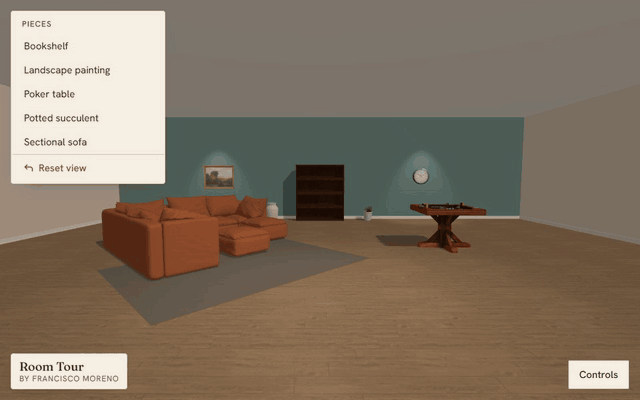
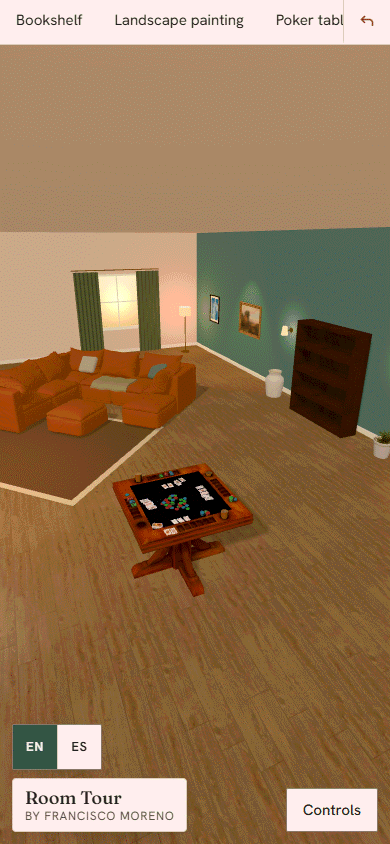
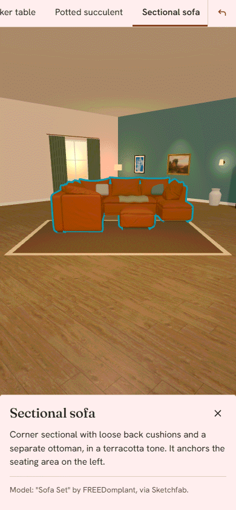
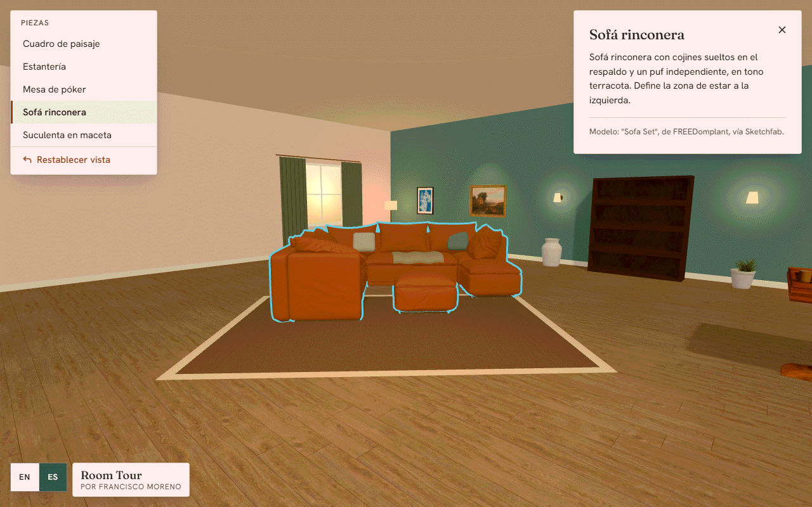

# 3D Room Tour & Descriptions

An interactive 3D living room that runs entirely in the browser. Walk around by clicking the floor, click or tap any piece of furniture to zoom in on it and read about it, and use the keyboard-friendly furniture list if you prefer not to use a pointer.

[](https://angular.dev/)
[](https://threejs.org/)
[](https://www.typescriptlang.org/)
[](https://vitest.dev/)
[](LICENSE)
[](https://room-tour-and-descriptions.vercel.app/)

**[Open the live demo](https://room-tour-and-descriptions.vercel.app/)**



|                                             Desktop                                              |                                        Mobile                                        |
| :----------------------------------------------------------------------------------------------: | :----------------------------------------------------------------------------------: |
|                             |                    |
|  |  |

The interface is available in English and Spanish ([Languages](#languages)); here the same view in Spanish:



## Table of contents

- [Features](#features)
- [Controls](#controls)
- [Languages](#languages)
- [Tech stack](#tech-stack)
- [Getting started](#getting-started)
- [Scripts](#scripts)
- [Architecture](#architecture)
- [Technical decisions](#technical-decisions)
- [Performance](#performance)
- [Credits and licenses](#credits-and-licenses)
- [Contributing](#contributing)
- [License](#license)
- [Author](#author)

## Features

- **Walk the room**: click or tap the floor and the camera glides there, limited to the room bounds.
- **Inspect furniture**: click or tap a piece and the camera moves close to it, the piece gets an outline and a description panel opens. Hovering shows which pieces are clickable.
- **Orbit, pan and zoom** with mouse, touch (one-finger rotate, two-finger pan and pinch) or the arrow keys.
- **Accessible alternative**: a list of the furniture (plus an _Initial view_ button) works with the keyboard and screen readers; the description panel is announced as a dialog and closes with `Esc`.
- **Responsive**: the initial framing adapts to portrait screens so all three pieces stay visible on a phone.
- **Cozy, finished room**: sage accent wall, wall prints, curtains, lamps and soft textiles, with warm light and soft shadows.
- **English and Spanish**: detected from the browser and switchable with the EN | ES selector.
- **Loading and error states**: a progress screen while models download, and clear messages (with a retry button) if WebGL is unavailable, the context is lost or a model fails to load.
- **Light assets**: the three original models were reduced from about 51 MB to about 2.4 MB, and the whole `src/assets` folder (seven models, textures, fonts, social image) weighs about 3.9 MB (see [Performance](#performance)).

## Controls

| Input                                       | Action                     |
| ------------------------------------------- | -------------------------- |
| Left mouse drag / one finger                | Look around                |
| Right mouse drag / two fingers / arrow keys | Slide sideways             |
| Wheel / pinch                               | Zoom                       |
| Click or tap the floor                      | Walk to that point         |
| Click or tap a piece of furniture           | Zoom in and read about it  |
| `Esc`                                       | Close the details panel    |
| `Home`                                      | Return to the initial view |

The **? Help** button in the corner reopens these instructions at any time.

## Languages

The interface is available in English and Spanish.

- **Detection.** On the first visit the language is the first one in the browser's preference list that the app supports (`navigator.languages`); anything else falls back to English.
- **Selector.** The **EN | ES** switch next to the title changes the language at once and remembers it in `localStorage` (key `room-tour.locale`), so it wins over detection on later visits. It also updates `<html lang>`, the page title and the meta description.
- **Dictionaries.** All user-facing text lives in `src/app/i18n/`: `en.ts` is bundled with the app, `es.ts` is a separate chunk loaded only when needed. Both implement the `Messages` type in `messages.ts`, so a missing key is a compile error. If the Spanish chunk fails to load, the app stays in English and shows a non-blocking notice.
- **Add or change a string.** Add the key to the `Messages` type, then to `en.ts` and `es.ts`, and use it through `LocaleService.messages()`. `npm test` checks that both dictionaries have the same keys.
- **Add a language.** Add its code to `Locale`, `LOCALES` and `LOCALE_OPTIONS` in `messages.ts`, create a dictionary (copy `es.ts`) and register its lazy import in `locale.service.ts`.
- **Social preview.** The Open Graph and Twitter tags in `src/index.html` and `src/assets/brand/og.png` are static, so they stay in English.

## Tech stack

| Area            | Technology                                                                          |
| --------------- | ----------------------------------------------------------------------------------- |
| Framework       | Angular 21 (standalone components, signals, zoneless change detection)              |
| 3D              | Three.js 0.187 (`three/addons` for `GLTFLoader`, `OrbitControls`, `MeshoptDecoder`) |
| Language        | TypeScript 5.9 (strict)                                                             |
| Styling         | SCSS with CSS custom properties; no UI component library                            |
| Unit tests      | Vitest 4 with jsdom, through the Angular `@angular/build:unit-test` builder         |
| Lint and format | ESLint 9 (flat config, `angular-eslint`, `typescript-eslint`), Prettier             |
| Git hooks       | Husky + lint-staged                                                                 |
| CI              | GitHub Actions (lint, build, test on Node 22)                                       |
| Hosting         | Vercel (deploys on every push)                                                      |

## Getting started

Requirements: Node.js 22.12 or newer and npm.

```bash
git clone https://github.com/frxncismor/room-tour-and-descriptions.git
cd room-tour-and-descriptions
npm ci
npm start
```

Open <http://localhost:4200>. The viewer needs a browser with WebGL enabled.

## Scripts

| Command              | What it does                                         |
| -------------------- | ---------------------------------------------------- |
| `npm start`          | Dev server with live reload on port 4200             |
| `npm run build`      | Production build into `dist/interior-viewer/browser` |
| `npm run watch`      | Development build in watch mode                      |
| `npm test`           | Unit tests, single headless run (Vitest + jsdom)     |
| `npm run test:watch` | Unit tests in watch mode                             |
| `npm run lint`       | ESLint through the Angular CLI                       |
| `npm run lint:fix`   | ESLint with automatic fixes                          |
| `npm run lint:check` | ESLint plus a Prettier check (what CI runs)          |
| `npm run format`     | Format `src/` with Prettier                          |

## Architecture

```
AppComponent
└─ ViewerComponent            owns the <canvas> and wires the services
   ├─ LoadingScreenComponent  progress bar while the models download
   ├─ ErrorOverlayComponent   WebGL unavailable / context lost
   ├─ ErrorBannerComponent    a model failed to load, with retry
   ├─ HelpPanelComponent      controls for mouse, touch and keyboard
   ├─ DescriptionPanelComponent  furniture details (dialog, Esc to close)
   └─ ObjectListComponent     accessible list of furniture + initial view

Services (providedIn root, idempotent dispose)
  SceneService             renderer, render loop, resize, teardown; coordinates the rest
  CameraService            camera + OrbitControls, bounds, animated teleport and focus, reset
  ObjectInteractionService raycasting, hover, selection and outline (no loop of its own)
  ModelLoaderService       GLTFLoader + MeshoptDecoder, aggregated progress, floor placement
  RoomBuilderService       floor, walls, ceiling and lights from configuration
  ViewerStateService       signals: load progress/status, error, selected, hovered

config/   scene.config.ts (room, lights, models)  ·  decor.config.ts (decor pieces)
i18n/     LocaleService  ·  en.ts / es.ts (all user-facing text)
```

Source layout:

```
src/app/
├── components/   UI components
├── services/     3D and state services, each with its spec
├── config/       scene and decor configuration
├── i18n/         EN and ES dictionaries and the locale service
└── interfaces/   shared types
src/assets/
├── models/       optimized glTF models (sofa, poker_table, bookshelf, landscape_painting, wall_clock, succulent, ceramic_vase)
├── textures/     floor, rug, wall print and linen textures (WebP)
├── fonts/        Fraunces and Hanken Grotesk (WOFF2) and their OFL license
└── brand/        favicon, touch icon and social preview image
docs/             assets pipeline, README images and baseline captures
```

## Technical decisions

- **Zoneless Angular with signals.** The scene is driven by a single `requestAnimationFrame` loop that runs outside Angular, so a frame never triggers change detection; only meaningful state changes (selection, progress, errors) go through signals.
- **One render loop.** `SceneService` owns the loop and calls `update` on the camera and interaction services each frame. Services never schedule their own animation frames.
- **Selection by outline.** The selected piece gets cloned back-face meshes as an outline that is disposed on deselection, so repeated clicks never leak GPU resources.
- **Camera moves to what you click.** Floor clicks teleport with an eased animation clamped to the room bounds; furniture clicks frame the piece.
- **Assets optimized in place.** WebP textures and meshopt-compressed geometry, without KTX2 (no extra transcoder to ship). The originals are kept in git history. See [docs/assets-pipeline.md](docs/assets-pipeline.md) for how to regenerate them.
- **No UI component library.** The interface is a few small custom components, which keeps the bundle small and the visuals consistent.
- **Two languages, centralized text.** All user-facing strings live in typed dictionaries in `src/app/i18n/`; Spanish loads on demand, so English users never download it.

## Performance

Measured on a production build (`npm run build`):

| Metric                         | Value                                     |
| ------------------------------ | ----------------------------------------- |
| Initial JavaScript bundle      | 886.94 kB raw, about 202.5 kB transferred |
| 3D models (all seven)          | 3,100,101 B (about 3.1 MB)                |
| Textures (room, prints, linen) | 687,388 B (about 0.7 MB)                  |
| Fonts                          | 106,659 B (about 0.1 MB)                  |
| `src/assets` in total          | 4,044,814 B (about 3.9 MB)                |

The three original models went from about 51 MB to about 2.4 MB. Per-model sizes before and after are in [docs/assets-pipeline.md](docs/assets-pipeline.md).

The Spanish dictionary (3.71 kB) and the decor builder (8.30 kB) load as separate chunks. Other measurements on the final build:

| Metric                                                   | Value                                                                   |
| -------------------------------------------------------- | ----------------------------------------------------------------------- |
| Frame time, mobile CPU throttled 4×                      | 14.05 ms median (gate: under 16.7 ms); desktop 1.75 ms                  |
| Lighthouse accessibility (EN and ES, mobile and desktop) | 100 in all four runs                                                    |
| Lighthouse performance                                   | 28 mobile / 56 desktop in EN, 27 / 54 in ES (throttled, shared machine) |
| Colour contrast (WCAG AA)                                | 12 of 12 token pairs pass                                               |
| Lights                                                   | 7, only one casts shadows                                               |

### How the assets are optimized

Models are optimized in place with `scripts/optimize-models.mjs` (`@gltf-transform/cli` through `npx`, not a dependency): dedup, weld and prune, textures resized (at most 1024 px) and converted to WebP at quality 85, and geometry compressed with meshopt and quantization. Room textures are plain WebP made from the 1K originals. The originals are not kept in the working tree. The full pipeline, the per-piece policy and the regeneration steps are in [docs/assets-pipeline.md](docs/assets-pipeline.md).

## Credits and licenses

### Sketchfab models (sofa, poker table, bookshelf)

The three furniture models come from [Sketchfab](https://sketchfab.com/) and are used under the Sketchfab Standard license. Credit to their authors:

| Model                                 | Author       | Source                                                                                                            |
| ------------------------------------- | ------------ | ----------------------------------------------------------------------------------------------------------------- |
| SOFA SET                              | FREEDomplant | [Sketchfab](https://sketchfab.com/3d-models/sofa-set-2fc4feb7793144f5ae04901082d4d3d2)                            |
| Poker Board Game Table - Downloadable | Lília Mara   | [Sketchfab](https://sketchfab.com/3d-models/poker-board-game-table-downloadable-c68dbd76122840b59c8783f623fde050) |
| BookShelf                             | Twpic        | [Sketchfab](https://sketchfab.com/3d-models/bookshelf-ed697dcb7e634c1e92ed0192364588e6)                           |

License terms: <https://sketchfab.com/licenses>. The models were resized, texture-compressed and quantized for the web; the geometry and design are the authors' work.

### Poly Haven (decor pieces and room textures)

The decor and the floor and rug textures come from [Poly Haven](https://polyhaven.com/) and are released under CC0. CC0 does not require attribution; they are credited here as a courtesy.

| Piece                  | Author                            | Source                                                       |
| ---------------------- | --------------------------------- | ------------------------------------------------------------ |
| Fancy Picture Frame 01 | Rob Tuytel, Rico Cilliers         | [Poly Haven](https://polyhaven.com/a/fancy_picture_frame_01) |
| Wall Clock             | PierreB3D                         | [Poly Haven](https://polyhaven.com/a/wall_clock)             |
| Potted Plant 04        | James Ray Cock                    | [Poly Haven](https://polyhaven.com/a/potted_plant_04)        |
| Ceramic Vase 02        | James Ray Cock                    | [Poly Haven](https://polyhaven.com/a/ceramic_vase_02)        |
| Laminate Floor 02      | Dario Barresi, Charlotte Baglioni | [Poly Haven](https://polyhaven.com/a/laminate_floor_02)      |
| Poly Wool Herringbone  | colormass, Rico Cilliers          | [Poly Haven](https://polyhaven.com/a/poly_wool_herringbone)  |

### Wall prints and fabric

The four botanical prints hanging in the room are public-domain works, reproduced from [Wikimedia Commons](https://commons.wikimedia.org/) (resized and converted to WebP). The linen texture is CC0.

| Piece                         | Author                   | Date    | Source and license                                                                                                                     |
| ----------------------------- | ------------------------ | ------- | -------------------------------------------------------------------------------------------------------------------------------------- |
| _Spiraea aruncus (Tyrol)_     | Anna Atkins              | 1851–54 | [Commons](<https://commons.wikimedia.org/wiki/File:Spiraea_aruncus_(Tyrol)_MET_DT5664.jpg>), cyanotype, The Met, CC0                   |
| _Osmunda regalis (Australia)_ | Anna Atkins              | c. 1850 | [Commons](<https://commons.wikimedia.org/wiki/File:Anna_Atkins_-_Osmunda_Rigalis_(Australia)_-_Google_Art_Project.jpg>), public domain |
| _Pteris aquilina_             | Anna Atkins              | c. 1850 | [Commons](https://commons.wikimedia.org/wiki/File:Anna_Atkins_-_Pteris_aquilina_-_Google_Art_Project.jpg), cyanotype, public domain    |
| _Felce_                       | William Henry Fox Talbot | 1839    | [Commons](https://commons.wikimedia.org/wiki/File:Felce_MET_DP202191.jpg), salted paper print, The Met, CC0                            |
| Rough Linen (fabric texture)  | colormass, Rico Cilliers |         | [Poly Haven](https://polyhaven.com/a/rough_linen), CC0                                                                                 |

Atkins and Fox Talbot died in 1871 and 1877, so their work is in the public domain; the Met releases its scans under CC0. None of the assets in the project require attribution (there are no CC-BY pieces); they are credited as a courtesy. Sources, exact files and the commands that reproduce the textures are in [docs/assets-pipeline.md](docs/assets-pipeline.md).

### Fonts

[Fraunces](https://github.com/undercasetype/Fraunces) (headings) and [Hanken Grotesk](https://github.com/marcologous/hanken-grotesk) (interface text) are licensed under the SIL Open Font License 1.1. The license text is in [src/assets/fonts/OFL.txt](src/assets/fonts/OFL.txt).

## Contributing

Setup, commands, code standards and the commit format are in [CONTRIBUTING.md](CONTRIBUTING.md).

## License

The source code is released under the [MIT License](LICENSE). The 3D models, textures, prints and fonts keep their own licenses (see above).

## Author

Built by **Francisco Moreno** · [GitHub](https://github.com/frxncismor)
